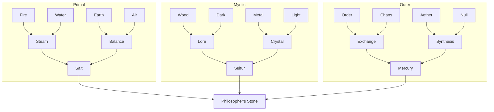
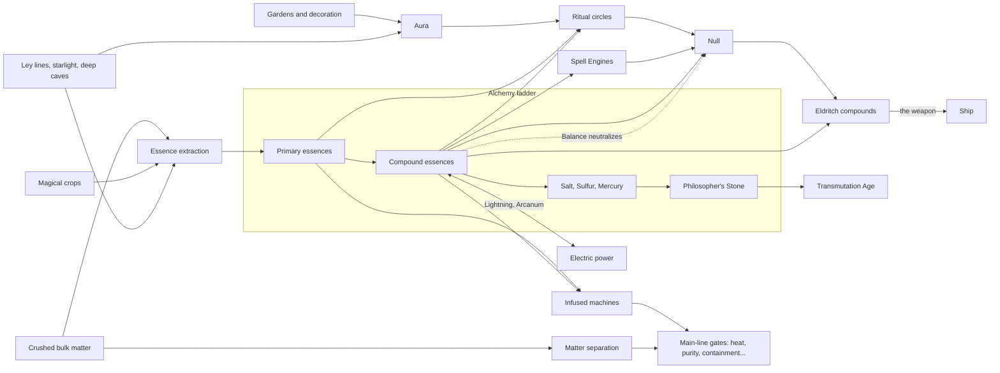

# Magic Branch

Ideas for magic as a side branch in [Tiers](Tiers.md), next to Power, Logistics, Biology, and the rest. Magic is on the Tentative list in [Ideas](Ideas.md) (magic, magical crystals, rituals, magitech, eldritch), and this doc replaces the narrower "Crystals" branch sketched in [Tiers](Tiers.md). Nothing here is decided.

Builds on: [Modded Minecraft](../Prior%20Art/Modded%20Minecraft.md) for what worked and didn't in magic mods, [Resource Gathering](../Prior%20Art/Resource%20Gathering.md) for bulk matter and separation, [Mechanics](Mechanics.md) for rewards and cosmetics.

Core Idea: Magic Is a Second Composition

[Resource Gathering](../Prior%20Art/Resource%20Gathering.md) proposes that every block carries a **material composition** (granite is 60% silica, 15% iron...) that machines separate out. Magic adds a **second, hidden composition** to everything: its **essences**.

- Granite might be mostly *Earth* with a trace of *Fire*. A glow mushroom is *Wood* and *Light*. Coal is *Fire* and *Dark*.
- Tech machines pull out matter. Magic machines pull out essence. The same input stream feeds both.
- Essences are **fluids** (or gases, or light), so they move through pipes and tanks like any other fluid. Logistics stays the core skill.
- This is Thaumcraft's aspects, but extracted and piped like GregTech chemistry instead of scanned and spent by hand.

[Quests](Quests.md) already has a hook: the **Steam Extractor** is described as extracting "essences or juice from things". That can be the first magic machine the player sees.

---
# What Went Wrong Before

The magic mods in [Modded Minecraft](../Prior%20Art/Modded%20Minecraft.md) were consistently "cool, but". Their complaints are the design brief.

| Mod | Complaint | Rule for Lotomation |
|---|---|---|
| Botania | Gathering and replacing components, too manual, underpowered in a tech pack, a random progression gate, obfuscated on purpose | Magic must be **automatable**, **legible**, and never a random gate on tech |
| Blood Magic | Altars suck to build, rituals manual and grindy | Multiblocks are simple to build, and rituals run on automation |
| Astral Sorcery | Tedious, doesn't integrate with any other mod | Magic **feeds and is fed by** the tech branches |
| Thaumcraft | Taint is annoying, research gets tedious | Magical waste is a resource, never a spreading punishment. Research is discovery, not chores |
| Ars Nouveau | Rituals more arcane (derogatory) than Thaumcraft | Explain everything in the quest book |
| ProjectE | Breaks the pack, irresistible | Magical transmutation is limited and lossy until the Transmutation Age |
| Mystical Agriculture | (Liked) Magic plants to avoid mining, but too many plants, farming not automated | Keep the "grow your resources" fantasy, fully automatable, fewer and broader crops |

And the general wish: **magic is cool**. The fantasy should feel different from tech, even though it plugs into the same factory.

---
# Essences

Each primary essence maps to a **tech axis** from [Tiers](Tiers.md), which is how magic integrates: it is a parallel route to the same problems. Compounds fill in the axes the primaries leave out, so a player who wants the magic route to an axis has to build an alchemy line for it.

The set borrows from several traditions:

- **Greek classical elements**: Fire, Water, Air, Earth, and Aether as the fifth.
- **Vedic Pancha Mahabhuta**: the same five, with Akasha (space, the medium sound travels through) as the fifth.
- **Chinese Wu Xing**: Wood, Fire, Earth, Metal, Water, and the cycles between them.
- **Ayurvedic doshas**: Vata (air and space: movement), Pitta (fire and water: transformation), Kapha (earth and water: structure). These become compounds.
- **Alchemy's tria prima**: Salt, Sulfur and Mercury. These become the top compounds.
- **Thaumcraft**: the primal aspects (Aer, Terra, Ignis, Aqua, Ordo, Perditio) and many of its compound recipes.

### Primary essences

| Essence    | Attributes                                  | Inspiration                       | Natural sources                                        | Factory role                                                   | Parallels tech axis      |
| ---------- | ------------------------------------------- | --------------------------------- | ------------------------------------------------------ | -------------------------------------------------------------- | ------------------------ |
| **Fire**   | Heat, burning, passion, transformation      | Ignis, Agni/Tejas, Wu Xing Fire   | Coal, lava, deep rock, desert sand, sulfur vents       | Heat without fuel, smelting, coil infusion                     | Heat                     |
| **Water**  | Flow, cleansing, dissolving, adapting       | Aqua, Apas/Jala, Wu Xing Water    | Rivers, sea, rain, clay, wet caves, kelp               | Solvent for reactions, washing ores, carrying other essences   | Chemistry                |
| **Air**    | Movement, breath, freedom, sound            | Aer, Vayu                         | High altitude, wind-swept peaks, cave drafts, feathers | Movement: pumps, fans, belt speed, item throwing               | Logistics                |
| **Earth**  | Stability, weight, endurance, ground        | Terra, Prithvi, Wu Xing Earth     | Stone, deep bands, soil, clay                          | Drilling, compression, structure, sturdier machines            | Depth                    |
| **Wood**   | Growth, renewal, spring, healing            | Wu Xing Wood, Herba               | Trees, plants, fungi, roots, peat                      | Growth, crop speed, healing, biology boosts                    | Biology                  |
| **Metal**  | Refinement, conduction, edges, autumn       | Wu Xing Metal, Metallum           | Ores, metal fractions, meteorites, ruins               | Conductivity, cutting and refining, wire and cable infusion    | Power grade              |
| **Light**  | Purity, clarity, truth, day                 | Lux, Yang                         | Sunlight, glow fungi, quartz, snowfields, fireflies    | Purity, precision, cleansing                                   | Purity / precision       |
| **Dark**   | Concealment, rest, absorption, night        | Tenebrae, Yin                     | Deep caves, coal, obsidian, night, ink sacs            | Hiding, absorbing, containment                                 | Containment (Exotic Age) |
| **Order**  | Structure, law, pattern, memory             | Ordo                              | Crystals, geodes, honeycomb, salt flats, ancient ruins | Logic, sorting, filters, recipe memory, stable output          | Information              |
| **Chaos**  | Entropy, chance, change, breaking           | Perditio                          | Gravel, scree, rubble, storm sites, crushed waste      | Breaking things apart, crushing, luck and variance             | Separation               |
| **Aether** | Space, spirit, connection, the medium       | Quintessence, Akasha, Qi          | Ley lines, starlight, high aura, rare crystals         | Range, aura, wireless transfer, the medium other magic runs in | Scale                    |
| **Null**   | Absence, waste, wrongness, the void between | Thaumcraft's flux (Vitium), taint | None. Made as waste by rituals, spells and alchemy     | The base of every Eldritch compound                            | none                     |

### Compound essences

Compounds are made by combining two essences. Each pair makes at most one compound, so the recipe list stays learnable.

| Compound       | Recipe         | Attributes                                 | Inspiration                       | Factory role                                                                              | Parallels tech axis             |
| -------------- | -------------- | ------------------------------------------ | --------------------------------- | ----------------------------------------------------------------------------------------- | ------------------------------- |
| **Steam**      | Fire + Water   | Pressure, power, transformation            | Pitta (transformation)            | Early magical power, pressure, speeding up processing                                     | Pressure / power                |
| **Magma**      | Fire + Earth   | Molten heat, depth, melting                | Fire feeding Earth in Wu Xing     | Smelting, melting stone, heat at depth                                                    | Heat, Depth                     |
| **Lightning**  | Fire + Air     | Energy, speed, sparks                      | Potentia                          | Converting essence to and from electric power                                             | Power grade                     |
| **Forge**      | Fire + Metal   | Craft, alloying, tempering                 | Fire melting Metal in Wu Xing     | Alloying, tool and machine infusion, metalworking                                         | Heat                            |
| **Binding**    | Water + Earth  | Cohesion, shape, holding                   | Kapha (structure, cohesion)       | Binding, structure, storage capacity, mortar for multiblocks                              | Scale                           |
| **Life**       | Water + Wood   | Vigor, healing, fertility                  | Victus, Water nourishing Wood     | Healing, crop growth, keeping cultures alive                                              | Biology                         |
| **Gravity**    | Earth + Dark   | Gravity, density, burden                   | Gravity, Earth's heaviness        | Compression, dense materials, holding things down                                         | Pressure / vacuum               |
| **Magnetism**  | Metal + Air    | Attraction, polarity, pull                 | Lodestone                         | Magnetic separation, item magnets                                                         | Separation                      |
| **Balance**    | Earth + Air    | Harmony, stillness, equilibrium            | Taiji, yin and yang               | Neutralizing Null, stabilizing unstable processes                                         | none (magic upkeep)             |
| **Ice**        | Water + Order  | Cold, stillness, preservation              | Gelum                             | Cooling, freezing, cryogenics, superconductors                                            | Pressure / vacuum               |
| **Motion**     | Wood + Metal   | Speed, momentum, travel                    | Motus                             | Belt and pipe speed, pumps, item routing                                                  | Logistics                       |
| **Prana**      | Air + Aether   | Breath, flow, vital current                | Vata, Prana, Qi                   | Flow between machines, wireless transfer, ley line taps                                   | Logistics, Scale                |
| **Crystal**    | Metal + Light  | Clarity, focus, lattice                    | Vitreus                           | Lenses, focusing, data storage                                                            | Purity / precision, Information |
| **Mechanism**  | Metal + Order  | Gears, repetition, precision               | Machina, Instrumentum             | Machine speed, autocrafting, clockwork automation                                         | Scale, Logistics                |
| **Arcanum**    | Metal + Aether | Enchantment, conduction, magitech          | Praecantatio                      | Magitech conductors: wire that carries essence and power together                         | Power grade                     |
| **Lore**       | Wood + Dark    | Knowing, perception, sight                 | Cognitio                          | Divination as data, sensing, smarter filters                                              | Information                     |
| **Starlight**  | Light + Dark   | Celestial, guidance, distance              | Astral Sorcery, celestial magic   | Renewable essence, celestial rituals                                                      | Purity / precision              |
| **Exchange**   | Order + Chaos  | Trade, conversion, equivalence             | Permutatio                        | Converting surplus into what's short, fuel for the Transmutation Pool                     | Separation                      |
| **Oblivion**   | Chaos + Null   | Death, decay                               | Breaking apart, into nothing      | Entropy, recycling, breaking anything down into its parts                                 | Separation                      |
| **Gnosis**     | Light + Null   | Watching, knowledge                        | Sensing, into seeing everything   | Scanning, monitoring, scrying                                                             | Information                     |
| **Synthesis**  | Aether + Null  | Catastrophe, upheaval, technology          | Magitech, into technology itself  | Data, machines, circuitry                                                                 | Information, Power grade        |
| **Rot**        | Wood + Null    | Rot, disease, hives, return, compost       | Decay, into disease and hives     | Bacteria and fungal cultures, bioleaching, Breaking down organics, fertilizer             | Biology                         |
| **Hollow**     | Air + Null     | Heights, sky, void, isolation              | Emptiness, into the void, vacuum  | Megastructures, launches, containment, sealing things away                                | Scale, Pressure / vacuum        |
| **Ruin**       | Fire + Null    | Fire, destruction, pain, division          | Heat, into destruction            | Extreme heat, plasma, damage                                                              | Heat                            |
| **Abyss**      | Earth + Null   | Pressure, depth, confinement               | Weight, into crushing depth       | Extreme compression, deep bores                                                           | Depth, Pressure / vacuum        |
| **Umbral**     | Dark + Null    | The unseen, darkness                       | Hiding, into the unseen           | Stealth, hiding the shipyard                                                              | Containment                     |
| **Wrath**      | Metal + Null   | Predators, weapons, violence               | Metalworking, into weapons        | Weapons for the player and ship, combat; peacefully: demolition, shredding, cutting tools | Separation, Depth               |
| **Distortion** | Order + Null   | Illusion, madness, lies, masks, fate, luck | Conversion, into mimicry and lies | Mimicry, illusions, disguises, decoration, luck in gambling, manipulating enemies         | Logistics, Scale                |
| **Vitality**   | Water + Null   | Plants, meat, life, growth                 | Life, into unchecked growth       | Grown organic machinery                                                                   | Biology                         |

For Eldritch compounds, the Inspiration column says what the base essence becomes when Null pushes it to its extreme.

Null gives the player a choice: neutralize it, or refine it into Eldritch compounds. Waste stays a resource, and the closed loop is visible in the recipe table.

| +      | Fire      | Water    | Earth   | Air       | Wood   | Metal     | Light     | Dark   | Order      | Chaos    | Aether    |
| ------ | --------- | -------- | ------- | --------- | ------ | --------- | --------- | ------ | ---------- | -------- | --------- |
| Water  | Steam     |          |         |           |        |           |           |        |            |          |           |
| Earth  | Magma     | Binding  |         |           |        |           |           |        |            |          |           |
| Air    | Lightning |          | Balance |           |        |           |           |        |            |          |           |
| Wood   |           | Life     |         |           |        |           |           |        |            |          |           |
| Metal  | Forge     |          |         | Magnetism | Motion |           |           |        |            |          |           |
| Light  |           |          |         |           |        | Crystal   |           |        |            |          |           |
| Dark   |           |          | Gravity |           | Lore   |           | Starlight |        |            |          |           |
| Order  |           | Ice      |         |           |        | Mechanism |           |        |            |          |           |
| Chaos  |           |          |         |           |        |           |           |        | Exchange   |          |           |
| Aether |           |          |         | Prana     |        | Arcanum   |           |        |            |          |           |
| Null   | Ruin      | Vitality | Abyss   | Hollow    | Rot    | Wrath     | Gnosis    | Umbral | Distortion | Oblivion | Synthesis |

### The three principles

Alchemy's **tria prima** sit above the compounds, made from compounds rather than primaries. They are late, expensive, and needed for transmutation.

| Principle   | Theme   | Recipe               | Attributes                | Meaning in alchemy               | Factory role                                                    |
| ----------- | ------- | -------------------- | ------------------------- | -------------------------------- | --------------------------------------------------------------- |
| **Salt**    | Arcane  | Steam + Balance      | Fixity, body, permanence  | The body: fixity, what stays     | Preserving, stopping decay, locking a machine to perfect output |
| **Sulfur**  | Natural | Lore + Crystal       | Soul, combustion, change  | The soul: what burns and changes | Catalysts, speeding reactions, activating dormant materials     |
| **Mercury** | Arcane  | Exchange + Synthesis | Spirit, fluidity, binding | The spirit: what flows and binds | Fluid transfer between anything, quicksilver conduits           |

Salt + Sulfur + Mercury together make the **Philosopher's Stone** (working name), magic's route into the Transmutation Age.

## Magic as an alternate route

Because each essence parallels a tech axis, magic can offer **alternate solutions** to main-line gates:

- A Heat Age blast furnace needs better coils, or **Fire infusion** on the coils.
- A Precision Age cleanroom needs filters, or **Light wards** that keep a room pure.
- Exotic Age containment needs powered fields, or **Dark** bindings.
- Information Age data comes from analyzers, or from **Lore** divination.

The magic route should have a **different cost profile**, not a strictly better one: less power, but a steady essence supply; smaller footprint, but needs a decent aura nearby. Players who like magic lean on it, players who don't can ignore it, and most will mix.

---
# Magic Tiers

The magic track has 11 tiers, each mirroring the tech tier in the same row of [The Progression](Tiers.md#the-progression): the same kind of new problem, solved the magic way. Both tracks lead into 3 combined tiers. Each magic tier introduces 4 essences.

| Tier | Name                   | Mirrors           | New mechanic                                                                                | New essences                         |
| ---- | ---------------------- | ----------------- | ------------------------------------------------------------------------------------------- | ------------------------------------ |
| 1    | **Folk Magic**         | Stone Age         | Charms, herbs, glow baskets, noticing essences in things                                    | Fire, Water, Air, Earth              |
| 2    | **Essence Extraction** | Bronze Age        | Hand-fed extractors that pull essences out of things                                        | Wood, Metal, Light, Dark             |
| 3    | **Runecraft**          | Steam Age         | Permanent glyphs and ritual circles that run on their own, essences in pipes, Null as waste | Order, Chaos, Aether, Null           |
| 4    | **Magitech**           | Electric Age      | First compounds; essence to and from power; Arcanum conductors                              | Steam, Lightning, Arcanum, Magnetism |
| 5    | **Alchemy**            | Industrial Age    | Bulk alchemy, potions, the Transmutation Pool; neutralize or refine Null                    | Balance, Rot, Binding, Life          |
| 6    | **Infusion**           | Heat Age          | Infusion strength as a stat: infused machines, tools and coils                              | Magma, Forge, Ice, Wrath             |
| 7    | **Warding**            | Precision Age     | Warded rooms: purity, hiding, disguise, perfect output                                      | Crystal, Salt, Umbral, Distortion    |
| 8    | **Geomancy**           | Atomic Age        | Ley line nexus design, aura fields as a placement rule                                      | Prana, Gravity, Oblivion, Exchange   |
| 9    | **Spellcraft**         | Information Age   | Spell Engines, divination as data                                                           | Lore, Gnosis, Mechanism, Synthesis   |
| 10   | **Celestial**          | Orbital Age       | Starlight, constellations, sky rituals, levitation                                          | Starlight, Hollow, Motion, Sulfur    |
| 11   | **Summoning**          | Fusion Age        | Summoning and binding great spirits in containment circles; familiars that work             | Ruin, Abyss, Vitality, Mercury       |
| C1   | **Eldritch**           | Exotic Age        | Null compounds at full strength, combined with exotic matter                                |                                      |
| C2   | **The Great Work**     | Transmutation Age | The Philosopher's Stone from Salt, Sulfur and Mercury                                       |                                      |
| C3   | **Departure**          | Departure         | Every essence feeds the ship                                                                |                                      |
| ∞    | **Planar**             | Post-game         | Pocket planes with their own rules                                                          |                                      |

Magitech (tier 4) is still the heart of the integration: the first point where magic and electricity convert into each other, so a player's magic wing can power their tech wing and vice versa. Embers (steampunk magic) is the closest prior art for the feel.

## Essences per tier

Each of the 11 magic tiers introduces 4 of the 44 essences. The rules used:

- Primals in tier 1, mystics in tier 2, outers in tier 3, then compounds.
- Roughly primal compounds first, then mystic, then outer, but **fit with the tier comes first**.
- A **principle only arrives once both of its compounds exist**: Salt (Steam 4, Balance 5) at 7, Sulfur (Crystal 7, Lore 9) at 10, Mercury (Exchange 8, Synthesis 9) at 11.
- **Null compounds start at tier 5** with Rot, next to Balance, so the tier that teaches "Null must go somewhere" offers both choices at once: neutralize it with Balance, or refine it into Rot. After that there are one or two Null compounds in every tier.

Why each tier gets what it gets:

| Tier         | Essences                             | Why                                                                                                                   |
| ------------ | ------------------------------------ | --------------------------------------------------------------------------------------------------------------------- |
| 1 Folk Magic | Fire, Water, Air, Earth              | The primals.                                                                                                          |
| 2 Extraction | Wood, Metal, Light, Dark             | The mystics. Metal arrives with the first metals.                                                                     |
| 3 Runecraft  | Order, Chaos, Aether, Null           | The outers. Order sorts, Aether is the medium essences flow through, and automated magic makes its first waste, Null. |
| 4 Magitech   | Steam, Lightning, Arcanum, Magnetism | Power on the magic side: Steam and Lightning turn essence into power, Arcanum carries it, magnets drive generators.   |
| 5 Alchemy    | Balance, Rot, Binding, Life          | Byproducts (Balance or Rot), bulk multiblocks (Binding), potions (Life).                                              |
| 6 Infusion   | Magma, Forge, Ice, Wrath             | Heat and cold for infusion, and Wrath as tempered edges: cutting tools and demolition.                                |
| 7 Warding    | Crystal, Salt, Umbral, Distortion    | Purity (Crystal), perfect output (Salt), hiding (Umbral) and disguise (Distortion): the four kinds of ward.           |
| 8 Geomancy   | Prana, Gravity, Oblivion, Exchange   | Ley line taps (Prana), dense shielding (Gravity), decay (Oblivion), and Exchange, since fission transmutes elements.  |
| 9 Spellcraft | Lore, Gnosis, Mechanism, Synthesis   | Divination (Lore, Gnosis), clockwork logic (Mechanism), circuitry (Synthesis).                                        |
| 10 Celestial | Starlight, Hollow, Motion, Sulfur    | Starlight, the void above (Hollow), momentum for launches (Motion), and Sulfur, what burns, for the fuel.             |
| 11 Summoning | Ruin, Abyss, Vitality, Mercury       | A star's plasma (Ruin) and pressure (Abyss), life from nothing (Vitality), and Mercury, what binds.                   |

The combined tiers introduce no essences; they use all 44. The Philosopher's Stone is made in Magnum Opus (C2); see [Combined tiers](Tiers.md#combined-tiers).

---

# Lore Hooks

[Story](../Story.md) gives magic a strong reason to exist.

- **The planet is the source.** The home planet never discovered magic; it's a property of *this* world (the crystals, the ley lines). Part of why it was chosen, or a lucky accident.
- **Nanomachines can't sense it.** Magic isn't technology, so the enemy can't detect or corrupt it. That makes it useful for the secrecy the ship needs: **Dark wards** hide the shipyard, **illusions** disguise the factory.
- **The superweapon needs it.** The ship has to beat sentient nanomachines. A weapon they can't analyze or infect could be magitech. Magic is one of the two main tracks ([Tiers](Tiers.md#the-progression)): exposed early and optional to lean on, but required by the Exotic Age shield and weapon and by the Transmutation Age.
- **Organic matter only.** The teleporter only carries organic matter ([Mechanics](Mechanics.md)). Herbs, seeds, and familiars travel well; it's a reason the home planet can send magical seeds but not magical machines.

---

# Mechanics

## Essence Extraction

- **What**: Extractors, crucibles, and distillers pull essence out of items. Like matter separation, early machines get one or two essences and later ones pull more fractions and purer output.
- **Prior art**: Thaumcraft's crucible and smelting aspects out of items, Embers' melter, GregTech's extractor.
- **Fit**: The same crushed-stone stream from [Resource Gathering](../Prior%20Art/Resource%20Gathering.md) feeds both matter and essence lines. One input, two products.

## Aura and Ley Lines

- **What**: The world has an ambient **aura**, varying by biome, depth, and ley lines. Some magic machines draw from local aura, and overdrawing slowly lowers it until it recovers.
- **Prior art**: Nature's Aura (Minecraft), Thaumcraft vis, Astral Sorcery's starlight collection.
- **Compactness problem**: area-based resources push players to spread out. So aura should be **generated** as well as found: gardens, crystal growths, and decorations raise it. A compact base with a garden next to the magic wing does better than a sprawling one.
- **Defang**: low aura only slows things down. Nothing breaks, nothing spreads.

## Beauty and Harmony

- **What**: Magic machines work better near pleasant surroundings: plants, water features, decoration, symmetry. Like RimWorld's beauty stat or feng shui.
- **Fit**: Gives the "freedom to build and decorate" pillar a functional reward, but only in the magic branch, so pure tech players aren't forced to decorate.
- **Connects to**: [Mechanics](Mechanics.md) cosmetics, Trophy Room, the Construction branch.

## Ritual Circles

- **What**: Rituals are multiblocks drawn on the ground: glyphs, candles, crystals, pedestals in a pattern. Inputs go on pedestals, the ritual runs, outputs come out.
- **Prior art**: Blood Magic rituals, Thaumcraft infusion, Ars Nouveau and Occultism rituals, Botania's runic altar.
- **Rules from the complaints**:
  - The pattern is shown in the quest book and with an in-world ghost overlay. No guessing.
  - Glyphs are permanent once drawn. No re-chalking.
  - Pedestals accept belt and pipe input, and the ritual can be triggered by logic signals. Fully automatable from the start.
- **Fit**: Spatial design puzzles that look nothing like a machine row, which gives the magic wing of a base its own character.

## Spell Engines

- **What**: Programmable spells built from **spell cards** in a sequence, inspired by Noita's wands. Cards are effects (Heat, Freeze, Compress, Grow, Transmute, Push) and modifiers (Multicast, Repeat, Spread, Delay, Trigger). A sequence runs on whatever passes through.
- **Two uses**:
  - **On tools**: a wand or staff for the player, used for mining, building, moving, and (if it exists) combat. A Noita-style toy for players who want one.
  - **In machines**: a **Spell Engine** block runs a spell sequence on items moving through it. A sequence like *Heat, Compress, Heat* could turn sand into glass and then into a crystal lens in one block.
- **Prior art**: Noita (wand building, spell modifiers), Psi (programmable spells), Hex Casting (pattern-drawn spells), Magicka (element combinations).
- **Fit**: Programming as an optional depth layer, like Factorio's logic but more playful. Spell cards are collectible, which ties into [Mechanics](Mechanics.md) collections and card packs.
- **Risk**: Noita-style combos are fun because they can break things. Spell Engines need costs (essence per cast, cooldown) so a clever sequence is a big win but not infinite free matter.

## Alchemy

- **What**: Potions, reagents, and liquid reactions. Some reactions happen in the world (pour Ice essence on lava), some in brewing machines.
- **Randomized recipes**: Noita randomizes certain alchemy recipes per world seed. Lotomation could randomize a few **secret** recipes per world, discovered by experimenting and recorded in a journal. Most recipes stay fixed so guides still work.
- **Prior art**: Noita's material alchemy, Potion Craft, Alchemy Factory (an automation game built around alchemy, whose reviews praise it for staying manageable instead of overwhelming), Opus Magnum (alchemy as a machine puzzle).
- **Fit**: Potions give the player temporary buffs (mining speed, flight, night vision), and reagents feed other magic machines.

## Transmutation Pool

- **What**: A magical liquid that turns items into related items when dropped in, like Terraria's **Shimmer**. Iron becomes nickel, a sapling becomes another sapling, a broken tool becomes its materials.
- **Fit**: An early, limited taste of transmutation, long before the tech Transmutation Age. Useful for converting surplus into what's short.
- **Balance**: Fixed, lossy conversions only. The ProjectE lesson from [Modded Minecraft](../Prior%20Art/Modded%20Minecraft.md): never "anything into anything" this early.

## Magical Crops

- **What**: Plants that grow materials or essences, like Mystical Agriculture. A Fire bloom grows Fire essence, an iron vine grows iron fractions.
- **Rules from the complaints**: fewer, broader crops (one per essence, a handful for materials), and fully automatable harvesting from the start.
- **Fit**: Overlaps the Biology branch. Magical crops could be the point where Biology and Magic meet.

## Enchantment and Infusion

- **What**: Infuse machines, tools, belts, and pipes with essences for bonuses. A Fire-infused furnace runs hotter, an Order-infused splitter can filter by more rules, an Earth-infused drill reaches deeper.
- **Fit**: Overlaps with Machine Gems and Random Affixes in [Mechanics](Mechanics.md). Magic could be the craftable, deterministic version, and gems the random, gacha version.

## Celestial Cycles

- **What**: Moon phases, constellations, and day/night boost some magic processes. Starlight is a renewable source, like solar power.
- **Prior art**: Astral Sorcery's constellations, Terraria's blood moons and lunar events.
- **Defang** (*Dark Patterns*, Playing by Appointment): cycles are short (an in-game day or a few), and essence can be **stored** to even them out, exactly like solar plus batteries. A celestial event is a bonus, never a requirement.

## Familiars and Spirits

- **What**: Summoned spirits and familiars that do work: carry items between containers, tend crops, watch machines.
- **Prior art**: Occultism's spirit workers, Thaumcraft golems, Botania's flower helpers, RuneScape Summoning.
- **Logistics risk**: AE2 and Ender IO conduits trivialized logistics. Spirits must stay a **different** logistics option, not a better one: limited carry capacity and range, a need for upkeep essence, and slow speeds. Good for small, awkward jobs that belts handle badly, never a replacement for a belt network.
- **Fit**: Overlaps with Pets in [Mechanics](Mechanics.md). A familiar could be a pet that works.

## Null (Magical Waste)

- **What**: Magic processes produce **Null**, a byproduct, like Thaumcraft's flux and taint or Factorio's pollution.
- **Defang**: Taint was annoying because it spread and wrecked things. Null doesn't spread or destroy. It has to be piped away and stored or processed, like any other byproduct.
- **Fit**: Null is also a primary essence, and every Eldritch compound is an essence plus Null. Waste from early magic becomes the resource for late magic, a closed loop.

## Wards

- **What**: Area effects from placed ward stones: hide the base from nanomachines, keep a room pure (cleanroom alternative), keep mobs out, keep aura from draining.
- **Fit**: Lore payoff (secrecy), and an alternate route through several main-line gates.

---

# How Magic Connects to Everything

- **Shares inputs with tech**: the same bulk matter stream feeds both matter separation and essence extraction.
- **Shares logistics with tech**: essences are fluids on pipes, rituals take belt input, and Motion and Prana speed up the same belts and pipes.
- **Alternate routes**: every main-line axis has a magical alternative with a different cost profile, through a primary essence or a compound.
- **An alchemy ladder of its own**: primaries, then compounds, then the three principles, then the Philosopher's Stone. Each rung is a new production chain, the same shape as the tech tiers.
- **Two-way power**: Lightning and Arcanum convert between essence and electricity, so a magic wing can power a tech wing and back.
- **A Null loop**: magic makes Null, Balance can neutralize it, and the eldritch tier consumes it.
- **Biology overlap**: Wood, Life and Decay, magical crops, and familiars sit between Magic and Biology.
- **Mechanics overlap**: spell cards are collectible, familiars are pets that work, infusions are the deterministic cousin of Machine Gems, and Distortion (fate) tie into the casino.

---

# Open Questions

- **Randomized recipes**: fun discovery, but they break wiki guides and co-op coordination. A few per world, or none?
- **Spell Engines**: how much power should a clever sequence have before it outshines normal machines?
