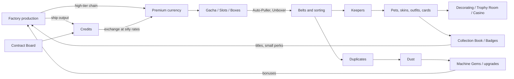

# Mechanics

A brainstorm of gameplay mechanics to layer on top of the core factory loop. Most of them come from the mechanics of free-to-play, gacha, and MMO games (*Dark Patterns*, *Activities In Other Games*), rebuilt with **fake currency only**. Nothing in the game costs real money, ever.

The aims are **engagement, variety, and parody**: we take the mechanics that predatory games (Diablo Immortal, gacha games, mobile "VIP" systems) use to drain wallets, and turn them into toys, jokes, and **production goals for the factory**.

Nothing here is decided. Each entry says what it is, where it comes from, how it could hook into the core gameplay, and what it connects to.

---

# Guiding Ideas

## The big trick: the factory pays for everything

In a predatory game, the player's wallet feeds the slot machine. In Lotomation, **the factory** feeds it. Every currency, pull, reroll, speed-up, and upgrade material should be something the player can eventually **produce automatically**.

That turns each dark pattern into a logistics problem:

- Gacha pulls become "build a machine that pulls 600 times an hour, and sort the results on belts".
- Duplicate protection becomes a recycling chain.
- Grinding becomes something machines do while you watch.

The more predatory the original mechanic, the funnier it is when a conveyor belt does it for you.
## Guardrails from the Design Pillars

| Pillar                              | What it means for these mechanics                                                                                                      |
| ----------------------------------- | -------------------------------------------------------------------------------------------------------------------------------------- |
| Automate everything                 | Every random or timed mechanic should have an automated version by mid game. Hand-pulling is the tutorial, not the endgame.            |
| All resources renewable             | Currencies come from production, not finite caches. Nothing limited-time is ever gone for good.                                        |
| Freedom to build, decorate, destroy | Cosmetics, skins, and collectibles give decorating a purpose and a reward stream.                                                      |
| Fun alone or with friends           | Every social mechanic must work solo (NPCs, drones, or self-gifting stand in for friends).                                             |
| Don't destroy the player's stuff    | No upgrade that can break an item, no decay, no losing a collection. Failure only wastes the materials that were spent on the attempt. |
| Compact factory                     | Rewards for density and efficiency, not for sprawling outward.                                                                         |

## Dark patterns

| Pattern                    | Treatment                  | How                                                                                                                        |
| -------------------------- | -------------------------- | -------------------------------------------------------------------------------------------------------------------------- |
| Playing by appointment     | Defang                     | Events and timed things exist, but nothing is lost by missing them. Events can be replayed any time from an archive.       |
| Daily rewards              | Parody + defang            | The login calendar never resets, it just waits for you. See [Patient Login Calendar](#patient-login-calendar).             |
| Grinding                   | Automate                   | The grind exists so a machine can do it.                                                                                   |
| Advertisements             | Parody                     | In-universe joke ads, optional, see [In-Game Ads](#in-game-ads). Builds on *Funny Ads*.                                    |
| Infinite treadmill         | Accept, opt-in             | Infinite research and prestige for people who want it. The story has a real ending (the ship launches).                    |
| Wait to play               | Parody                     | Timers exist and the factory makes the skips. See [Timers and Skip Tokens](#timers-and-skip-tokens).                       |
| Pay to skip                | Parody                     | Same as above.                                                                                                             |
| Premium currency           | Parody                     | Confusing exchange rates as a running joke. See [Currencies](#currencies).                                                 |
| Pay to win                 | Parody                     | Single-player "pay to win" with factory output is just progression. See [VIP Levels](#vip-levels).                         |
| Artificial scarcity        | Parody                     | "LIMITED TIME!" offers whose countdown visibly resets. Never actually limited.                                             |
| Recurring fee              | Parody                     | A "subscription" machine that eats a trickle of currency for a small passive perk.                                         |
| Gambling / loot boxes      | Embrace                    | The core of the parody.                                                                                                    |
| Power creep                | Accept                     | Natural to tiered tech. Old items get recycled into new ones, so nothing is worthless.                                     |
| Waste aversion             | Parody + defang            | Leftover currency gets swept into a "Change Jar" that pays out later. Storage is never capped in a way that deletes items. |
| Anchoring tricks           | Parody                     | Absurd items in the shop, like the 9,999,999 currency Golden Toilet.                                                       |
| Social pyramid scheme      | Parody                     | "Refer a Robot", see [Refer a Robot](#refer-a-robot).                                                                      |
| Social obligation / guilds | Defang                     | Shared goals that never punish absence.                                                                                    |
| Reciprocity                | Defang                     | Gifting exists, nobody is ever asked to return the favor.                                                                  |
| Invested value             | Accept                     | The player's factory is the investment, and it is never taken away.                                                        |
| Endowed progress           | Embrace                    | Badges, collections, progress bars.                                                                                        |
| Complete the collection    | Embrace                    | Big collections with satisfying set bonuses.                                                                               |
| Illusion of control        | Parody                     | "Lucky" rituals that visibly do nothing, see [Superstitions](#superstitions).                                              |
| Variable rewards           | Embrace                    | The point of most of this doc.                                                                                             |
| Aesthetic manipulation     | Embrace (the fanfare part) | Over-the-top dings, confetti, and rarity beams. Never the misleading-UI part.                                              |
| Optimism / frequency bias  | Parody                     | A fake "global feed" of NPC players winning, see [Fake Global Feed](#fake-global-feed).                                    |

---

# Lore Hooks

Two ideas from [Story](../Story.md) that tie a lot of this together.

## Organic-only shipments from home

The teleporter can only reconstruct **organic matter**. So anything the home planet sends must be organic: seeds, bacteria cultures, food, wood, leather, cloth, animals. That makes a great source for random rewards:

- Supply drops are **organic only**, which explains why loot is seeds, pets, outfits, and cultures rather than machines.
- Pets and outfits are natural cosmetics: they are what the teleporter can carry.
- It feeds the **biology branch** from [Ideas](Ideas.md) (Tentative list) and [Resource Gathering](../Prior%20Art/Resource%20Gathering.md) suggestion 5.

## The nanomachines run the shop

The enemy is sentient nanomachines. What if their weapon of conquest was **monetization**? They conquered other civilizations by getting them hooked on gacha.

- The in-game shop is run by a suspiciously friendly merchant who is "definitely not a nanomachine".
- Late in the game the player realizes the shop is the enemy, and the factory they built to farm it is the tool to beat it.
- This makes the parody part of the story instead of only a tone, and gives a reason the shop gets more aggressive (more pop-ups, more "offers") as the player nears the end.
- An endgame "break the bank" goal: automate pulls so hard that the merchant's economy collapses.

Optional, but it gives every mechanic below a home.

---

# Currencies

The backbone that most other mechanics plug into. Several fake currencies, in the mobile-game tradition of "too many currencies" (itself worth a joke).

## Credits (soft currency)

- **What**: The everyday currency, earned by shipping factory output: quota contracts, production quests, selling surplus.
- **Fit**: Directly measures how productive the factory is. Shipping is a sink for overflow, which matters with infinite resources.
- **Connects to**: [Contract Board](#contract-board), [Market Terminal](#market-terminal), every shop.

## Premium currency (name TBD)

- **What**: The "premium" currency. In a real gacha game it is bought with money; here it is a **manufactured item** that comes from a long, high-tier production chain (or in small amounts from quests and badges).
- **Name ideas**: *Lotos* (Lotomation / lotto), *Hope Crystals*, *Shinies*, *Nanogems*.
- **Parody**: Exchange rates that make no sense. A Credits-to-premium shop with bundles like *1,280 for the price of 1,000, +10% BONUS!*, with a "best value" tag on the worst value bundle.
- **Fit**: Making it a physical item means it can go on belts, into storage, and into machines like [Auto-Puller](#auto-puller).
- **Connects to**: [Gacha Banners](#gacha-banners), [Slot Machine](#slot-machine), [Cosmetics](#cosmetics).

## Specialty currencies

- **Dust / Stardust**: from recycling duplicates, see [Duplicate Recycling](#duplicate-recycling).
- **Event tokens**: from events, spent in event shops (events are replayable, so tokens never expire).
- **Badge points**: from [Badges](#badges).
- **Pachinko balls**: literal ball bearings, see [Pachinko Parlor](#pachinko-parlor).

## Change Jar

- **What**: Every shop leaves odd amounts of currency behind (you have 37, everything costs 50). Instead of guilting the player, leftovers trickle into a jar that eventually pays out a reward.
- **Parody of**: Waste aversion.

---

# Random Rewards

## Quest Reward Pools

- **What**: Quests roll their rewards from a weighted pool instead of a fixed list (the [Quests](Quests.md) reward types already include *Choice*, so this is a sibling type, say *Random*).
- **Variants**: "Pick 1 of 3 random rewards", reroll for a small fee, pity so a rare reward is guaranteed after N rolls.
- **Fit**: Main quests keep fixed rewards so progression is never gated by luck. Side and repeatable quests use pools.
- **Connects to**: [Contract Board](#contract-board), [Mystery Boxes](#mystery-boxes), [Quests](Quests.md).

## Supply Drops from Home

- **What**: Periodic drop pods from the home planet, containing a random assortment of organic goods: seeds, cultures, pets, outfits, food.
- **Fit**: A trickle of variety that never requires gameplay. Could be triggered by milestones, by building a beacon, or by spending Credits on "shipping".
- **Lore**: [Organic-only shipments from home](#organic-only-shipments-from-home).
- **Connects to**: [Pets](#pets), [Outfits](#outfits), the biology branch.

## Mystery Boxes

- **What**: Loot boxes, in tiers (wooden, iron, gold, "nanite"). Opened by hand with full fanfare, or by machine.
- **Automation**: An **Unboxer** machine takes boxes in, spits contents out on a belt. Now sorting loot is a logistics job.
- **Fit**: Boxes are items, so they can be crafted, shipped, stored, and fed into machines.
- **Connects to**: [Auto-Puller](#auto-puller), [Duplicate Recycling](#duplicate-recycling).

## Gacha Banners

- **What**: Rotating banners of featured items (pets, skins, machine gems, collectible cards) with star rarities, a pity counter, and a "50/50" on the featured item.
- **Defang**: Banners rotate, but old banners are always available from a "rerun" archive. Pity carries over between banners.
- **Parody**: "Rate up!" that raises the odds from 0.6% to 0.7%. Banner art that is wildly more dramatic than the item you get.
- **Connects to**: [Auto-Puller](#auto-puller), [Collectible Cards](#collectible-cards), [Machine Gems](#machine-gems).

## Auto-Puller

- **What**: A machine that consumes premium currency and pulls on a banner, continuously. Output goes on a belt.
- **Fit**: The punchline of the whole system: a gacha game where the gacha is automated. It forces sorting (filter splitters by rarity), storage, and recycling.
- **Tiers**: Faster pulls, multi-pull (10x with a guaranteed 4-star), "pity-aware" pulling that stops when the featured item drops.
- **Connects to**: [Transport](../Types%20of%20Things/Transport.md) splitters, [Duplicate Recycling](#duplicate-recycling).

## Duplicate Recycling

- **What**: Duplicates are recycled into Dust, which buys specific items from a Dust shop or upgrades the item ("constellations", "ascension").
- **Fit**: A recycling chain, which matches the closed-loop idea in [Resource Gathering](../Prior%20Art/Resource%20Gathering.md) suggestion 7.
- **Connects to**: [Machine Gems](#machine-gems), [Collectible Cards](#collectible-cards).

## Slot Machine

- **What**: A literal slot machine block. Insert currency (or items), pull the lever, win prizes.
- **Prizes**: Currency, boxes, cosmetics, rare materials, joke prizes (a single dirt block with a legendary beam).
- **Automation**: A **Lever Puller** module, or the slot machine accepts belt input and outputs winnings. Redstone-like logic (Factorio-style wires from [Types of Things Summary](../Types%20of%20Things/Types%20of%20Things%20Summary.md)) can read the result and react.
- **Variants**: Themed slots per tech age, progressive jackpots that grow as the factory runs, a "near miss" mode as a joke.
- **Connects to**: [Casino District](#casino-district), [Superstitions](#superstitions).

## Pachinko Parlor

- **What**: Pachinko, using **ball bearings the factory makes**. Balls are won and exchanged for prize tokens, which are exchanged for prizes at a "totally separate" counter (a parody of how real pachinko parlors work around gambling laws).
- **Fit**: Ball bearings are a real factory product, so this is a sink for a production line. The physics board could be a fun little simulation.
- **Connects to**: [Casino District](#casino-district).

## Sieving as a Loot Table

- **What**: [Resource Gathering](../Prior%20Art/Resource%20Gathering.md) already suggests separating materials out of bulk matter with drop tables (Ex Nihilo sieves). Lean into the presentation: rare fractions get the gacha treatment, with a sparkle and a sound.
- **Fit**: Puts variable rewards into the core resource loop, at no cost to the design.

## Lucky Finds in the World

- **What**: Worldgen places rare things to find while exploring: derelict caches from an earlier failed attempt, buried supply pods, fossilized organics, glowing geodes.
- **Fit**: A reason to explore the cubic-chunk world downward. Never required, so it doesn't push outward sprawl.
- **Connects to**: [Badges](#badges) (exploration), [Lore Logs](#lore-logs).

## Fishing

- **What**: A classic random-loot minigame. Fish, junk, treasure, and the occasional absurd item. Later, automated fishing nets.
- **Fit**: Organic outputs for the biology branch (fish oil, bone meal, scales). Relaxing downtime.
- **Connects to**: [Collection Book](#collection-book), [Pets](#pets).

---

# Collections

## Collectible Cards

- **What**: A trading card collection that comes in **packs**. Subjects: machines, materials, home-planet heroes, a bestiary of nanomachine types, joke cards, foil variants.
- **Fit**: Cards could have a small effect when slotted into a "Card Binder" machine, but the main value is completion.
- **Packs**: Bought with Credits, earned from quests, crafted from paper and ink in the factory. A pack machine and a card sorter make it automatable.
- **Stretch**: The cards could make up a playable card game (see the TCG folder), as a minigame inside the game.
- **Connects to**: [Gacha Banners](#gacha-banners), [Duplicate Recycling](#duplicate-recycling), [Trophy Room](#trophy-room).

## Collection Book

- **What**: One book that tracks everything collectible: materials discovered, cards, pets, outfits, fish, lore logs, badges.
- **Set bonuses**: Completing a page gives a cosmetic, a title, or a small QoL perk (never something mandatory).
- **Fit**: Turns the huge item counts of a GregTech-style game into a collection to complete.

## Badges

Taken from City of Heroes, whose badge categories map onto a factory game well:

| CoH category | Lotomation version |
|---|---|
| Exploration | Reach depth bands, biomes, special worldgen structures |
| History | Read lore logs and home-planet transmissions |
| Accomplishment | Finish side quest chains, contracts |
| Achievement | Milestones: first steel, first 1,000 circuits, first megawatt |
| Accolade | Rare feats that unlock a small permanent perk |
| Invention | Craft every recipe in a category |
| Defeat | Defeat each nanomachine variant (if combat exists) |
| Event | Complete an event (replayable, never lost) |
| Consignment | Sell things at the [Market Terminal](#market-terminal) |
| Day Job | Log out next to certain machines and get a small bonus on return |

- **Fit**: Badges are counters, so they are easy to make and easy to add hundreds of. Titles are the reward.
- **Connects to**: [Titles](#titles), [Collection Book](#collection-book).

## Lore Logs

- **What**: Collectible audio/text logs from the home planet, the earlier failed attempt, and the nanomachines.
- **Fit**: Delivers [Story](../Story.md) without cutscenes. Found in the world, in supply drops, and as quest rewards.

## Trophy Room

- **What**: Display cases, card frames, pet beds, mannequins for outfits, a mounted-fish wall. Put your collection on display.
- **Fit**: Gives decorating (a design pillar) a reason and a reward. A "museum score" could count toward badges.

---

# Cosmetics

## Pets

- **What**: Companion animals that follow the player, live in the base, or sit on machines.
- **Lore**: Organic, so the teleporter can send them. Also bred or grown via the biology branch.
- **Variants**: Vanity pets (purely cosmetic), and "buff" pets (City of Heroes) that give a tiny bonus, like a cat that naps on a furnace for +2% speed.
- **Fit**: A big pool for gacha, drops, and breeding. Breeding pets for traits uses the same genetics system the biology branch would need anyway.
- **Connects to**: [Gacha Banners](#gacha-banners), [Supply Drops from Home](#supply-drops-from-home), [Pet Arena](#pet-arena).

## Outfits

- **What**: Clothing and armor appearances, dyes, hats, capes. Organic materials (cloth, leather) make them teleport-safe.
- **Fit**: Multiplayer identity. Craftable from factory textiles too, so it's not only a gacha reward.

## Machine Skins

- **What**: Skins for machines, belts, pipes, and power poles. A "Legendary Gilded Macerator" with particle effects and a unique crunch sound. Animated belts. Themed sets (steampunk, chrome, organic, "nanite corruption").
- **Fit**: Probably the best cosmetic for this game, since players look at their machines far more than at themselves. Ties directly to decorating.
- **Connects to**: [Gacha Banners](#gacha-banners), [Season Track](#season-track).

## Titles

- **What**: Text titles shown with the player's name. "the Belt Whisperer", "Certified Gambling Addict", "Destroyer of Nanomachine Economies".
- **Fit**: Cheap to make, great badge and achievement rewards.

## Emotes, Name Plates, Effects

- Emotes for multiplayer, colored name plates, footstep trails, a confetti burst when a production goal is met.

---

# Progression Layers

## Machine Gems

A Diablo Immortal "Legendary Gems" parody.

- **What**: Gems with star ratings socket into machines for bonuses (speed, output, byproduct chance, power efficiency). Gems rank up by feeding them duplicates or Dust.
- **Parody**: Rank 10 of a 5-star gem needs an absurd number of duplicates. In Diablo Immortal that's thousands of dollars. Here it's a long-running production line.
- **Fit**: Per-machine upgrades fit the "grow output per block, not per area" goal in [Resource Gathering](../Prior%20Art/Resource%20Gathering.md) suggestion 6. Encourages compactness.
- **Risk**: Must not become mandatory for balance. Bonuses stay modest, or gems are optional overclocking on top of normal upgrades.
- **Connects to**: [Gacha Banners](#gacha-banners), [Duplicate Recycling](#duplicate-recycling), [Enhancement Upgrades](#enhancement-upgrades).

## Quality Rolls

- **What**: Crafted items and machines roll a quality tier (common, uncommon, rare, epic, legendary), like Factorio: Space Age's quality system. Higher quality means better stats.
- **Fit**: Real precedent in a factory game. It turns into a sorting and recycling problem: filter legendaries out, recycle the rest for another roll.
- **Connects to**: [Transport](../Types%20of%20Things/Transport.md) filter splitters, [Duplicate Recycling](#duplicate-recycling).

## Random Affixes / Modules

- **What**: Machine upgrade modules roll random affixes (City of Heroes invention enhancements, Diablo affixes). Set bonuses when a line of machines all carry pieces of the same set.
- **Fit**: "Set bonus for a production line" rewards building neat, uniform lines.
- **Connects to**: Machine upgrade slots in [Machines](../Types%20of%20Things/Machines.md).

## Enhancement Upgrades

- **What**: Upgrade an item from +1 to +15 with rising failure chances, the Korean MMO classic.
- **Defang**: Failure never breaks or downgrades the item (pillar: don't destroy the player's stuff). It only consumes the materials. A "Protection Scroll" that protects against nothing, because nothing can be lost, as a joke.
- **Fit**: A sink for surplus production, with automation (an "Enhancement Station" that keeps trying until +N).

## Mastery Board

From Albion Online's Destiny Board and RuneScape skills.

- **What**: Per-machine-type or per-category mastery. Running macerators levels "Macerator Specialist", which gives small bonuses to macerators.
- **Twist**: Mastery levels from the **factory's** throughput, not from player clicks. Automation is the way to level, the opposite of a RuneScape grind.
- **Possible skills**: Mining, Smelting, Logistics, Power, Chemistry, Biology, Construction, Gambling (yes, really).
- **Connects to**: [Badges](#badges), [Titles](#titles).

## Infinite Research

- **What**: Factorio-style repeating research (+X% productivity per level, rising costs).
- **Fit**: The healthy version of the infinite treadmill. Opt-in, after the story.

## Prestige

- **What**: After launching the ship, start a new world with a permanent bonus, a prestige badge, and new cosmetics.
- **Fit**: Replayability, and it parodies idle-game prestige. The old world is kept (never destroyed).
- A prestige button at the end of a 1000 hour game is an extremely funny button to have

## VIP Levels

- **What**: Mobile-game VIP tiers based on total premium currency **spent**. VIP 1 through VIP 15, with escalating and increasingly ridiculous perks: a golden name, a butler drone, the merchant calling you "Esteemed Patron", a red carpet that follows you.
- **Parody**: In real games VIP buys power. Here, since the currency comes from the factory, VIP level is really a measure of how big the factory is.

## Relics

- **What**: RuneScape Archaeology relics: rare finds that give passive, always-on bonuses, with a limited number of active slots.
- **Fit**: Rewards for exploring and lucky finds, with a choice (slots) to keep it interesting.

---

# Time-Based Mechanics

## Patient Login Calendar

- **What**: A daily login calendar, except missed days don't break the streak. It just waits.
- **Parody**: The calendar character is visibly hurt when you come back after a week, then gives you the reward anyway.

## Events

- **What**: Seasonal and themed events (holiday decorations, a "Nanomachine Invasion Week", a "Golden Week" casino event) with their own quests, tokens, and cosmetics.
- **Defang**: Events can be played any time from an archive. The current one is just the one being shown off. No FOMO.
- **Fit**: Variety, cosmetics, and a reason to try a new production challenge.

## Season Track

- **What**: A battle pass with free and "premium" tracks. Levels come from completing contracts and production goals.
- **Defang**: Seasons never expire. Old passes stay available. The "premium" track costs fake currency.
- **Parody**: A "Premium Plus Ultimate" tier that skips 25 levels, purchasable with factory currency.

## Day and Night

- **What**: Some things depend on time of day: night-blooming glow mushrooms (the Pern glow baskets in [Ideas](Ideas.md)), solar power, nocturnal pets.
- **Fit**: Already natural to a voxel world. Gives power storage a reason (also in [Ideas](Ideas.md)).

## Offline Progress

- **What**: The factory keeps producing while the player is away, as rates rather than simulation ([Resource Gathering](../Prior%20Art/Resource%20Gathering.md) suggestion 9). Logging back in shows an idle-game "While you were away..." screen.
- **Fit**: A natural fit with rate-simulated extractors, and a gentle parody of idle games.
- **Connects to**: [Badges](#badges) (Day Job).

---

# Activities

## Contract Board

- **What**: A board of procedurally generated production orders ("Deliver 500 copper wire in the next hour", "Keep 10 MW running for a day"), with random reward pools. Reroll a contract for a fee.
- **Fit**: The most natural repeatable activity for a factory game, and a steady source of Credits. Like Satisfactory's or shapez's hub goals, but randomized.
- **Connects to**: [Credits (soft currency)](#credits-soft-currency), [Quest Reward Pools](#quest-reward-pools), [Season Track](#season-track).

## Market Terminal

- **What**: An NPC market with fluctuating prices for materials. Sell surplus, buy what you're short on.
- **Fit**: A sink for overflow, and an optimization layer (which product is worth shipping today?). Could react to what the player floods it with.
- **Connects to**: [Credits (soft currency)](#credits-soft-currency), [Badges](#badges) (Consignment).

## Casino District

- **What**: A buildable district: slot machines, pachinko, a roulette wheel, a card table, a prize counter. All powered and fed by the factory.
- **Fit**: Decorating with a purpose. Players can design an over-the-top Las Vegas wing of the base, powered by their own machines.
- **Connects to**: [Slot Machine](#slot-machine), [Pachinko Parlor](#pachinko-parlor), [Trophy Room](#trophy-room).

## Treasure Hunts

- **What**: RuneScape clue scrolls: a chain of riddles and coordinates through the world, ending in a reward box.
- **Fit**: Exploration with a reward, and a natural user of cubic-chunk depth ("dig to Y=-300 under the twin peaks").

## Derelict Exploration

- **What**: Procedurally generated ruins from the earlier failed attempt, or nanomachine-corrupted zones, with loot and lore. Like RuneScape's Dungeoneering.
- **Fit**: An optional break from building. Keep it optional so the core stays about logistics.

## Nanomachine Incursions

- **What**: City of Heroes "Giant Monster" and zone-event style threats that appear and need dealing with.
- **Defang**: Incursions must never wreck the player's buildings. They attack shields, steal a little output, or simply present a fight with rewards. Could be toggled off for pure builders.
- **Fit**: Gives defensive builds a purpose. Ties to [Story](../Story.md).

## Pet Arena

- **What**: Pets battle in an arena (City of Heroes Gladiator, Pokémon). Win cosmetics and badges.
- **Fit**: Gives the pet collection something to do. Breeding for stats becomes a reason to run the biology branch.

## Factory Puzzles

- **What**: Hand-made or player-made production puzzles, Zachtronics style: fixed inputs, a target output, and a histogram comparing footprint and throughput to other players (or to your own past attempts). City of Heroes' Architect Entertainment is the "player-made" precedent.
- **Fit**: A pure expression of the core skill, in bite-sized form. Great for compactness, which the design wants to reward.

---

# Parody and Meta-Humor

## In-Game Ads

- **What**: Billboards, loading screens, and optional "watch an ad for a reward" buttons that play in-universe joke ads (in the voice of *Funny Ads*).
- **Fit**: Pure parody. Ads could advertise the factory's own products, or the nanomachine merchant's.

## Limited Time Offers

- **What**: Pop-up "OFFER ENDS IN 00:59!" deals whose countdown resets every time you look away. Starter packs at "90% off". "One-time only" offers that come back every week.
- **Defang**: Honesty switch turns them off. Prices are fake anyway.

## Fake Global Feed

- **What**: A ticker of fake NPC players winning legendaries: "xX_BeltLord_Xx just pulled the Golden Macerator!" Parodies frequency bias.
- **Fit**: Background humor. With real multiplayer, it could show real friends' pulls instead.

---

# How It All Fits Together

## The main loop

## Key connections

- **Currencies are the glue.** Almost everything spends or earns one of a few currencies, so a new mechanic only needs to plug into the economy.
- **Random rewards produce items, and items go on belts.** Every random mechanic becomes a logistics problem once automated (sorting by rarity, recycling dupes, storing collections).
- **Cosmetics feed decorating, and decorating feeds collection.** Skins, pets, and trophies give the build-and-decorate pillar a reward stream and something to show off.
- **Collection feeds back into small perks.** Badges, sets, and mastery give modest bonuses, which make the factory slightly better, which produces more currency.
- **Biology connects lore to rewards.** Organic-only shipments, pets, breeding, fishing, and glow mushrooms all share one system.
- **The story connects the parody.** If the nanomachines are the shop, the whole gambling layer has a narrative arc with an ending: automate it until it breaks.

## Mechanics that reinforce the core

These work directly with logistics and optimization:

- [Auto-Puller](#auto-puller) and [Mystery Boxes](#mystery-boxes) (sorting and recycling)
- [Quality Rolls](#quality-rolls) (filtering)
- [Contract Board](#contract-board) and [Market Terminal](#market-terminal) (what to produce)
- [Machine Gems](#machine-gems) and [Mastery Board](#mastery-board) (per-machine density)

## Mechanics that add variety

Breaks from building, so they should stay optional:

- [Fishing](#fishing), [Pet Arena](#pet-arena), [Treasure Hunts](#treasure-hunts), [Derelict Exploration](#derelict-exploration), [Nanomachine Incursions](#nanomachine-incursions), [Pachinko Parlor](#pachinko-parlor), card game minigame

## Pure flavor and parody

Cheap to add and mostly jokes:

- [In-Game Ads](#in-game-ads), [Limited Time Offers](#limited-time-offers), [Fake Global Feed](#fake-global-feed), [Superstitions](#superstitions), [Anchoring Shop](#anchoring-shop), [VIP Levels](#vip-levels), [Refer a Robot](#refer-a-robot), [Patient Login Calendar](#patient-login-calendar)

---

# Open Questions

- Should random rewards ever give **functional** power (gems, affixes, quality), or only cosmetics and convenience? Functional is more engaging but risks balance and the "pay wall" feeling, even with fake money.
- Where does premium currency come from in the early game, before the factory can make it? Quests and badges only, or a slow trickle from shipping?
- Does combat exist at all? Several mechanics (incursions, Defeat badges, pet arena) depend on it.
- How do server-wide mechanics (shared goals, global feed, market prices) work in single-player vs multiplayer?
