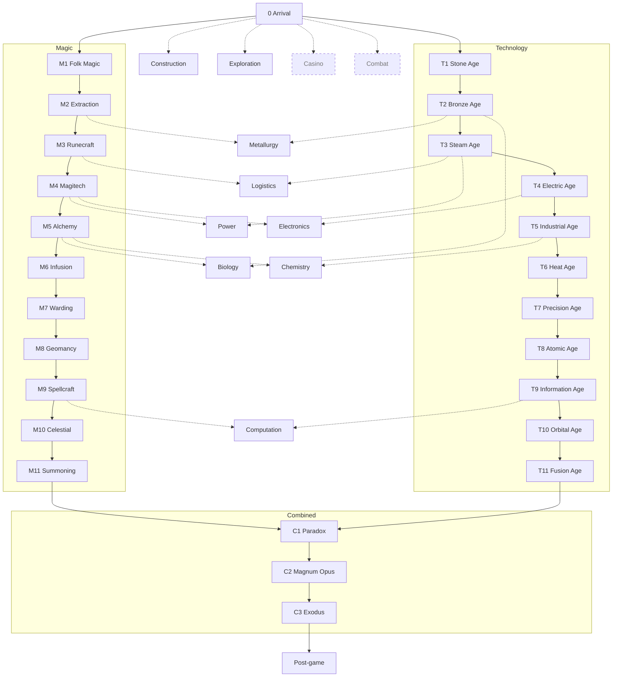
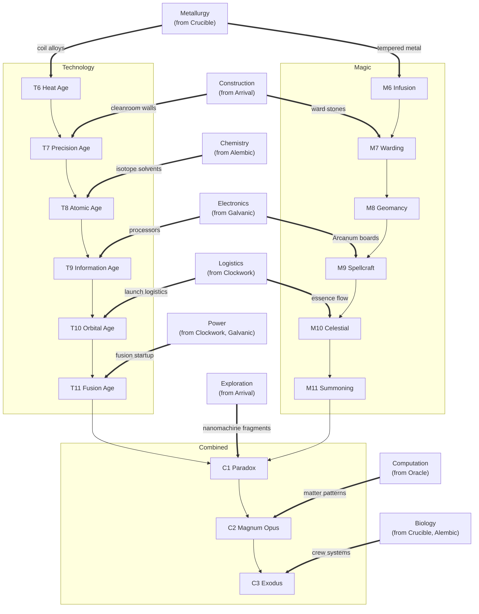

# Tiers

A brainstorm of the game's overall progression: the two main tracks and how they join, the side branches, and how it all is revealed to the player. Nothing here is decided.

The tracks and branches each have their own doc: [Tech Branch](Tech%20Branch.md) (T1 to T11), [Magic Branch](Magic%20Branch.md) (M1 to M11 and the magic system), and [Side Branches](Side%20Branches.md). Naming brainstorms are in [Name Ideas](Name%20Ideas.md).

The target scale is **GregTech: New Horizons**: functionally infinite for a sane player, with real, meaningful progress the whole way. GTNH's best quality is that each tier brings **a new problem to solve**, not just bigger numbers. Its worst is that the numbers eventually get large for the sake of being large. We want the first part without the second.

Related: [Quests](Quests.md) (the sketched Stone, Bronze, and Iron Age tabs), [Types of Things Summary](../Types%20of%20Things/Types%20of%20Things%20Summary.md) (the 7-step tier sketch), [Resource Gathering](../Prior%20Art/Resource%20Gathering.md) (no ores, bulk matter, depth bands), [Mechanics](Mechanics.md) (rewards and meta systems), [Design Pillars](../Design%20Pillars.md), [Story](../Story.md).

---

# Lessons from Prior Art

What the prior art docs and the packs in [Prior Art Summary](../Prior%20Art/Prior%20Art%20Summary.md) say about progression.

| Source | What works | What to avoid |
|---|---|---|
| **GregTech: New Horizons** | Every tier introduces a new mechanic: steam, electricity, coil heat in the blast furnace, cleanrooms, research for the assembly line, fusion. The tier name is the voltage, so the player always knows where they stand. Higher-tier machines run old recipes faster (overclocking), so old content gets faster instead of obsolete. Quest book tabs per tier. | Thousands of hours. Late-game numbers in the billions. Machines explode when over-voltaged. Much of the length comes from long, repetitive processing lines, not new ideas. |
| **Nomifactory / GTCEu packs** | A shorter, streamlined GregTech. A dedicated "processing lines" quest tab that shows whole chains visually. | Still leans on long chains in places. |
| **Satisfactory** | Tiers are unlocked by delivering parts to the **Space Elevator**, which is a big, visible goal in the world. A side tree (the MAM) for optional research. Alternate recipes found while exploring. | Late tiers are mostly "the same, but more". |
| **Factorio: Space Age** | Each planet is a **different rule set** (lava, scrap recycling, spoilage, freezing). Science packs make each tier's ingredients concrete. Infinite research at the end. | Planets mean multiple worlds simulated at once, which [Ideas](Ideas.md) rejects. |
| **Dyson Sphere Program** | The end goal is a **megastructure you can see in the sky**, built over a long time. | Progress pushes you outward across planets. |
| **Galacticraft / Abyssalcraft** (from [Modded Minecraft](../Prior%20Art/Modded%20Minecraft.md)) | Planets and dimensions look cool. | "Same grind 4 times": build part, go to place, get resource, repeat. |
| **Botania / Blood Magic / Astral Sorcery** (from [Modded Minecraft](../Prior%20Art/Modded%20Minecraft.md)) | Magic is cool. | Random progression gates from a mod that doesn't integrate with the rest. Manual, obfuscated, tedious. |
| **Applied Energistics 2 / Ender IO** (from [Modded Minecraft](../Prior%20Art/Modded%20Minecraft.md)) | Convenience. | Once unlocked, they trivialize logistics, which is the point of this game. |
| **Twilight Forest** (from [Modded Minecraft](../Prior%20Art/Modded%20Minecraft.md)) | Adventuring. | Forced linearity. |
| **Tinkers' Construct** (from [Modded Minecraft](../Prior%20Art/Modded%20Minecraft.md)) | Customization. | Most materials feel the same, so the player uses the best one and ignores the rest. |
| **Industrial Craft 2** (from [Modded Minecraft](../Prior%20Art/Modded%20Minecraft.md)) | Varied machines, good chains. | Explosions on over-voltage. Breaks "don't destroy the player's stuff". |

## Principles that come out of this

1. **Every era introduces a new mechanic.** If an era only adds bigger numbers, merge it into the previous one.
2. **Old content gets faster, not obsolete.** Higher-grade machines run old recipes at a speed bonus. Old chains get shortcuts (one advanced machine replacing a five-step chain) once the player has done them the long way.
3. **Player effort per era stays roughly flat; the numbers grow because the machines do.** A late-era capstone might need 100x the raw material of an early one, but the factory is 100x faster by then.
4. **Two tracks, with branches between them.** Technology and magic run in parallel as the two main tracks. The other branches grow off them, between them, and back into them, and can be explored in any order, so the player always has a choice (avoids forced linearity).
5. **Every branch integrates, and is eventually required.** Branches are exposed early and feel optional, but something late in each one becomes part of the new mechanic a later era introduces, the way Factorio needs every science pack. No Botania-style island that only gates itself.
6. **Logistics never gets trivialized.** Late-game logistics tech makes logistics *bigger and more interesting* (trains, drones, wireless with limits), never "one block that does everything".
7. **No punishment by destruction.** Over-voltage refuses to run, overheating throttles. Nothing explodes on its own.
8. **Grow down, not out.** Depth is a natural progression axis that keeps the factory compact ([Resource Gathering](../Prior%20Art/Resource%20Gathering.md)).
9. **Each material should matter.** A material earns its place by having a distinct job (heat resistance, conductivity, purity), not by being the next stat bump.
10. **Combat is optional.** Only combat-related things are gated behind combat, and anything that helps combat (like Wrath essence) also has a peaceful use.

---

# Axes of Progression

An era is defined by which axes it advances. Naming the axes up front helps make sure each era brings something new.

| Axis                   | What advances                                                                   | Example gates                                                                                    |
| ---------------------- | ------------------------------------------------------------------------------- | ------------------------------------------------------------------------------------------------ |
| **Power grade**        | Max power a machine can draw, like GregTech voltage. Each grade is 4x the last. | Wire and cable tiers, transformers, grade-specific circuits.                                     |
| **Heat**               | Max temperature a process can reach.                                            | Furnace types, coil materials, insulation.                                                       |
| **Pressure / vacuum**  | Pressurized and vacuum processes.                                               | Steam pressure, vacuum chambers, high-pressure reactors.                                         |
| **Purity / precision** | How clean and exact a process is.                                               | Cleanrooms, lithography, isotope separation.                                                     |
| **Depth**              | How deep bores and shafts reach, and so which material fractions are available. | Drill heads, heat and pressure resistance at depth.                                              |
| **Separation**         | Which fractions can be pulled out of bulk matter.                               | Crushers, sifters, washers, centrifuges, electromagnetic and chemical separation, then isotopes. |
| **Chemistry**          | Fluids, gases, reactions.                                                       | Distillation, electrolysis, catalysts.                                                           |
| **Information**        | Computation and data as a resource.                                             | Circuits, research data, programmable logic.                                                     |
| **Biology**            | Living things as machines.                                                      | Cultures, genetics, bioleaching.                                                                 |
| **Logistics**          | How far and how much can move.                                                  | Belt speed, pipes, trains, drones.                                                               |
| **Scale**              | Machine size and parallelism.                                                   | Multiblocks, parallel processing, megastructures.                                                |

---

# The Progression

After Arrival, progression splits into two tracks of 11 tiers each, **technology** and **magic**. The player advances both, in any order and at any pace. Both have to be finished to enter the 3 **combined** tiers, which need tech and magic together. A proposal, nothing decided.

**Each magic tier mirrors the tech tier in the same row**: it brings the same *kind* of new problem, solved the magic way. Stone Age and Folk Magic are both "doing it by hand"; the Heat Age and Infusion both add a stat that gates recipes. That keeps the two tracks feeling like two halves of one game, and it means each row can share an era name.

| #  | Era             | Tech tier                                      | Magic tier                                          | Shared concept                          | Power                      | Capstone (ship part)                    |
| -- | --------------- | ---------------------------------------------- | --------------------------------------------------- | --------------------------------------- | -------------------------- | --------------------------------------- |
| 0  | **Arrival**     |                                                |                                                     | Wake up with nothing but organic matter | None                       | (none, tutorial)                        |
| 1  | **Hearth**      | [Stone Age](Tech%20Branch.md#tech-tiers)       | [Folk Magic](Magic%20Branch.md#magic-tiers)         | Doing it by hand                        | Muscle                     | Survey beacon (marks the shipyard site) |
| 2  | **Crucible**    | [Bronze Age](Tech%20Branch.md#tech-tiers)      | [Essence Extraction](Magic%20Branch.md#magic-tiers) | First separation, hand-fed machines     | Burning fuel               | Shipyard foundation                     |
| 3  | **Clockwork**   | [Steam Age](Tech%20Branch.md#tech-tiers)       | [Runecraft](Magic%20Branch.md#magic-tiers)          | Full automation, fluids                 | **Drip** (G0)              | Hull frame                              |
| 4  | **Galvanic**    | [Electric Age](Tech%20Branch.md#tech-tiers)    | [Magitech](Magic%20Branch.md#magic-tiers)           | A network of a new kind of energy       | **Trickle** (G1)           | Wiring loom                             |
| 5  | **Alembic**     | [Industrial Age](Tech%20Branch.md#tech-tiers)  | [Alchemy](Magic%20Branch.md#magic-tiers)            | Bulk reactions, byproducts              | **Stream** (G2)            | Hull plating                            |
| 6  | **Athanor**     | [Heat Age](Tech%20Branch.md#tech-tiers)        | [Infusion](Magic%20Branch.md#magic-tiers)           | A stat that gates recipes               | **Current** (G3)           | Reactor housing                         |
| 7  | **Prism**       | [Precision Age](Tech%20Branch.md#tech-tiers)   | [Warding](Magic%20Branch.md#magic-tiers)            | Clean, sealed rooms                     | **Rapids** (G4)            | Guidance computer                       |
| 8  | **Nexus**       | [Atomic Age](Tech%20Branch.md#tech-tiers)      | [Geomancy](Magic%20Branch.md#magic-tiers)           | Placement puzzles around a core         | **Surge** (G5)             | Primary reactor                         |
| 9  | **Oracle**      | [Information Age](Tech%20Branch.md#tech-tiers) | [Spellcraft](Magic%20Branch.md#magic-tiers)         | Information as a resource               | **Torrent** (G6)           | Ship AI core                            |
| 10 | **Zenith**      | [Orbital Age](Tech%20Branch.md#tech-tiers)     | [Celestial](Magic%20Branch.md#magic-tiers)          | Leaving the ground                      | **Cascade** (G7)           | Launch first ship section               |
| 11 | **Sunforge**    | [Fusion Age](Tech%20Branch.md#tech-tiers)      | [Summoning](Magic%20Branch.md#magic-tiers)          | Containing something enormous           | **Flood** (G8)             | Main drive                              |
| C1 | **Paradox**     | Exotic Age                                     | Eldritch                                            | Matter and magic that shouldn't exist   | **Deluge** (G9)            | Shield generator, weapon                |
| C2 | **Magnum Opus** | Transmutation Age                              | The Great Work                                      | Making anything                         | **Tempest** (G10)          | Jump drive                              |
| C3 | **Exodus**      | Departure                                      | Departure                                           | Finish the ship                         | **Maelstrom** (G11)        | **Launch** (story ending)               |
| ∞  | **Horizon**     | Post-game                                      | Planar                                              | Beyond the story                        | **Cataclysm** (G12) and up |                                         |

The Era column is the name shared by both tracks in a row; each track keeps its own tier name for its tab. See [Name Ideas](Name%20Ideas.md#current-pick).

Each tech tier and combined tier ends with a **capstone**: a component of the **ship** from [Story](../Story.md). See [The Ship as the Progress Bar](#the-ship-as-the-progress-bar). What a magic tier ends in is still open.

## Arrival

- Introduces the [Story](../Story.md) premise: the player is reconstructed from organic matter only, so they arrive with nothing.
- Very short. The first few quests from [Quests](Quests.md) (Welcome, Gather Wood).
- A home-planet transmission explains the goal: build a ship in secret.

## Combined tiers

The combined tiers need both tracks finished, and each needs tech and magic together. They introduce no new essences; they use all 44.

### C1. Paradox: Exotic Age and Eldritch

- **Containment** as a mechanic: exotic matter must stay in powered containment while it moves. Losing power means losing the matter in transit (but never the machines).
- Antimatter as the ultimate power storage.
- The first combined tier: the Exotic Age and Eldritch magic together ([Magic Branch](Magic%20Branch.md)). Exotic matter and Null compounds can both be "wrong" in a fun way.
- The **weapon** capstone is a ship part. It is built and installed, never fired by the player, so it needs no combat to exist.

### C2. Magnum Opus: Transmutation Age and the Great Work

- [Resource Gathering](../Prior%20Art/Resource%20Gathering.md) suggestion 8: elements from power and base matter, UU-Matter style.
- Makes every material available anywhere, so endgame scarcity is about **energy and logistics**, not geography.
- Has to come late, or it trivializes everything before it (the ProjectE problem from [Modded Minecraft](../Prior%20Art/Modded%20Minecraft.md)).

The **Philosopher's Stone** is made in Magnum Opus as magic's half of transmutation: tech supplies the energy, magic the Stone, and Computation the matter patterns. After Departure, the Stone could be a reusable catalyst for the post-game: the key that opens pocket planes, or the start of a second Great Work.

### C3. Exodus: Departure

- Final assembly. Every earlier capstone gets upgraded and installed.
- The launch is a big set-piece event, and the end of the story: a **soft ending**, like launching the rocket in Factorio, building the Stargate in GregTech, or beating the Ender Dragon in Minecraft. The game is "finished", but the world is still there.
- The player keeps their world. Launch is a celebration, not a reset, and it opens a new avenue to progress in (see [Post-Game: Functionally Infinite](#post-game-functionally-infinite)).

---

# Side Branches

**Technology** ([Tech Branch](Tech%20Branch.md)) and **magic** ([Magic Branch](Magic%20Branch.md)) are the two main tracks. They run in parallel after Arrival and join in the combined tiers. Magic offers an alternate route through many tech gates, and each track also needs the other at points.

The other branches grow off one track, sit between the two, or feed back into them. Each unlocks at a tier on one or both tracks and grows with later tiers.

Branches are **exposed early and required later** (principle 5): each feels optional when it appears, but something late in it becomes part of the new mechanic a later tier introduces. Casino and Combat stay optional.

Each branch is described in detail in [Side Branches](Side%20Branches.md). In short, where each is exposed and where it becomes required:

| Branch                                          | Exposed from                  | Required by       | Because...                                                                                |
| ----------------------------------------------- | ----------------------------- | ----------------- | ----------------------------------------------------------------------------------------- |
| [Construction](Side%20Branches.md#construction) | Arrival                       | Prism (T7, M7)    | Cleanrooms and warded rooms are both buildings: sealed walls, airlocks, ward stones       |
| [Metallurgy](Side%20Branches.md#metallurgy)     | Crucible (T2, M2)             | Athanor (T6, M6)  | Coil alloys for heat, and Forge-tempered metal for infusion                               |
| [Chemistry](Side%20Branches.md#chemistry)       | Alembic (T5, M5)              | Nexus (T8)        | Solvents for isotope separation; alchemy is the same skill on the magic side              |
| [Electronics](Side%20Branches.md#electronics)   | Galvanic (T4, M4)             | Oracle (T9, M9)   | Processors for the advanced assembler, and Arcanum boards for Spell Engines               |
| [Logistics](Side%20Branches.md#logistics)       | Clockwork (T3, M3)            | Zenith (T10, M10) | Launch logistics: rates to an orbital shipyard, and essence flow for sky rituals (Motion) |
| [Power](Side%20Branches.md#power)               | Clockwork (T3), Galvanic (M4) | Sunforge (T11)    | Startup power for a fusion reactor; magic's Steam and Lightning generators can supply it  |
| [Exploration](Side%20Branches.md#exploration)   | Arrival                       | Paradox (C1)      | Derelict nanomachine fragments, reverse-engineered for the shield generator               |
| [Computation](Side%20Branches.md#computation)   | Oracle (T9, M9)               | Magnum Opus (C2)  | Matter patterns: transmutation needs the data recipe of every element it makes            |
| [Biology](Side%20Branches.md#biology)           | Crucible (T2), Alembic (M5)   | Exodus (C3)       | Crew systems: life support, food, grown organic parts (Vitality)                          |
| [Casino](Side%20Branches.md#casino)             | Arrival                       | never             | Optional                                                                                  |
| [Combat](Side%20Branches.md#combat)             | Arrival                       | never             | Optional                                                                                  |

---

# The Ship as the Progress Bar

Satisfactory's Space Elevator and DSP's Dyson sphere show that a big, visible goal in the world is a great progress bar. In Lotomation that's the **ship** from [Story](../Story.md).

- The **shipyard** is a structure the player builds in Stone Age (the survey beacon marks the site).
- Each era's capstone is a ship component, installed physically in the shipyard. The player watches the ship grow from a frame into a warship over hundreds of hours.
- Capstones need a **mix of everything from that era**, like Factorio science packs, so they check that the player actually automated the era's new mechanic.
- From the Orbital Age on, ship sections are launched to an orbital shipyard, visible in the night sky.
- Decorating the ship is part of the [Mechanics](Mechanics.md) cosmetics layer: paint jobs, a name, interior design.

---

# How Big Is "Big"

GTNH-like length, but with meaningful numbers. Rough targets to calibrate against, not commitments:

| Range | Tiers (both tracks) | Rough hours (a player who knows what they're doing) | Capstone raw material, rough order |
|---|---|---|---|
| Early | Arrival to 3 | 10 to 30 | Thousands of units |
| Mid | 4 to 7 | 50 to 200 | Tens to hundreds of thousands |
| Late | 8 to 11 | 200 to 600 | Millions |
| End | C1 to C3 | 600 to 1,000+ | Tens of millions, mostly in power |
| Post-game | Infinite | Open ended | Grows, but always with a new goal attached |

For reference, [Resource Gathering](../Prior%20Art/Resource%20Gathering.md) puts a Satisfactory endgame at around 550k raw units and GTNH's Stargate in the billions.

## Keeping numbers meaningful

- **Numbers grow because machines do.** The throughput the player can reach per era should grow about as fast as capstone costs, so effort per era stays flat.
- **Compression**: late eras can compress early materials (blocks of plates, bulk packaging) so a million copper doesn't mean a million anything in an inventory.
- **Parallel processing**: late multiblocks run many recipes at once (like GregTech parallels), so the player builds smarter, not wider.
- **Shortcuts replace chains.** Once a player has built a long early chain, a later era offers a one-machine shortcut for it. Long chains get *replaced* as the game goes on, not stacked endlessly.
- **New problems, not more of the same.** A new era should be identifiable by the new mechanic it introduces. If a planned era only means "bigger numbers", merge it.

---

# Post-Game: Functionally Infinite

After the ship launches, the game keeps going for anyone who wants it, without becoming numbers for their own sake. Each option attaches large numbers to a visible, novel goal.

**No prestige resets.** The game is far too long for Cookie Clicker-style restarts, as funny as that would be. The endgame is infinite by adding new frontiers to the same world, not by starting over. More endgame ideas are still needed.

- **Infinite depth**: cubic chunks make the world vertically unbounded. Deeper bands get richer and stranger forever, with diminishing returns. A frontier that never runs out and never pushes the factory outward.
- **Megaprojects**: projects that change the world or sky, like DSP's Dyson sphere: a Dyson swarm, a planetary shield, terraforming a biome, a space elevator. Each is long and visible.
- **Infinite research**: Factorio-style repeating levels with rising costs. Opt-in.
- **Grades beyond 11**: GregTech-style tiers past the story, each still introducing one new mechanic (or capped where ideas run out).
- **Nanite tech**: reverse-engineer the enemy. Self-replicating machines as a late logistics and construction mechanic (ties to Refer a Robot in [Mechanics](Mechanics.md)).
- **Pocket planes** (the Planar magic tier): small worlds with different **rules**, entered from the main world, like Factorio's planets but one at a time, so no multi-world simulation (rejected in [Ideas](Ideas.md)). A lava plane, an ice plane, a plane of scrap, a plane with no surface. Each is a new set of problems, and nothing is reset.
- **Factory puzzles and challenges** from [Mechanics](Mechanics.md).

---

# How It's Revealed to the Player

The quest book, modeled on a Minecraft modpack quest book like GTNH's ([Quests](Quests.md) already defines the quest format and tabs).

## Tab structure

- **Tracks**: one tab per tier on each track (Stone Age, Folk Magic, Bronze Age, Essence Extraction...), grouped under the shared era names, plus Arrival and the combined tiers. A tier's tab appears when its first quest becomes available.
- **Branches**: one tab per branch (Power, Logistics, Biology...). A branch tab appears when its first quest unlocks.
- **Reference tabs**:
  - **Tips** for non-obvious mechanics.
  - **Processing Lines**, like Nomifactory CEu: whole chains drawn as diagrams, unlocked as the player reaches them.
  - **Ship**: the shipyard's state, which components are done, which are next.
  - **Collections**: the [Mechanics](Mechanics.md) Collection Book.

## Revealing without spoiling

- **Silhouettes**: the next era's tab shows up as a locked silhouette with a name and one teaser line, so the player sees there's more ahead (endowed progress, used kindly).
- **Hidden quests**: some branch quests stay hidden until discovered, so exploration finds things.
- **Era briefings**: each new era opens with a transmission from home (a lore log) that explains what's needed and why. Delivers [Story](../Story.md) in small pieces.
- **Era capstone ceremony**: installing a ship component plays a short set-piece in the shipyard and unlocks the next era.
- **Recipe browser**: undiscovered items can show as "???" by default, with a setting to show everything for players who want to plan ahead.

## Quest types to add

[Quests](Quests.md) already lists Break Block, Checkbox, Crafting, Interact, Location, and Retrieval. Some additions would help a factory game:

- **Throughput**: produce N items per minute for a sustained time. Checks automation, not hand-crafting.
- **Power**: generate or store a given amount.
- **Delivery**: ship items to the shipyard (the capstone quests).
- **Build**: construct a multiblock or a cleanroom.
- **Discover**: reach a depth band or find a structure.

---

# Era and Branch Map

Two charts: where everything unlocks, and where each branch becomes required.

## Unlocks

After Arrival, technology and magic run as two tracks of 11 tiers, which join for the 3 combined tiers. Dotted lines show where a branch is first exposed; most are exposed by a tier on each track. Branches keep growing in every tier after that. Dashed boxes (Casino, Combat) are the branches that stay optional.

## Requirements

Each thick arrow shows the tier where a branch becomes **required**, and what that tier needs from it, from [Side Branches](#side-branches). Tiers before 6 need nothing from the branches. Casino and Combat never become required.

---

# Open Questions

- **Magic capstones**: tech tiers end in ship parts. What does a magic tier end in: enchantments or wards on the ship, or shared capstones that need both tracks?
- **Power grade names**: flow names are the current pick (see [Power Grades](Tech%20Branch.md#power-grades)). Celestial names might suit magic grades better.
- **Which late piece of each branch is required**: the table in [Side Branches](#side-branches) is a first sketch.
- **Endgame**: more ideas are needed for after Departure.
