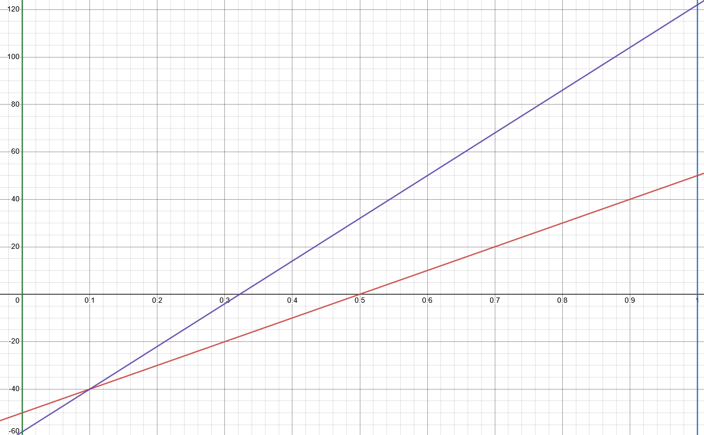

# Stages

1. Generate biome parameters
2. Calculate biomes
3. Calculate height
4. Filling in blocks
5. Subtractive features
6. Additive features
7. Subtractive structures
8. Additive structures
9. Decoration

# Biome Parameters

Five noise maps are generated to determine the fundamental properties of the world. Biomes specify which ranges of values they are valid for, so these will determine which biome each chunk is. Each parameter maps from 0 to 1, where 0 is the least amount of something and 1 is the most.

## Temperature

Temperature represents normal earth temperatures and is a linear range from 0 (representing about -50C) to 1 (representing about 50C).

|**Temperature Map**|_**°**_**C**|_**°**_**F**|
|---|---|---|
|0|-50|-58|
|0.25|-25|-13|
|0.5|0|32|
|0.75|25|77|
|1|50|122|

|**Conversion** To  From|**Noise**|_**°**_**C**|_**°**_**F**|
|---|---|---|---|
|**Noise**|f(x) = x|f(x) = 100x - 50|f(x) = 180x - 58|
|_**°**_**C**|f(x) = (x + 50) / 100|f(x) = x|f(x) = 1.8000x + 32|
|_**°**_**F**|f(x) = (x + 58) / 180|f(x) = (x - 32) / 1.8000|f(x) = x|

The below graph shows the mapping of temperature value on the x axis to temperatures in both Celsius (red line) and Fahrenheit (purple line) on the y axis.

## Height

The average height of the land, and is a cubic function. Around 0 it’s relatively flat but it spikes to more extremes as we move away from zero.

The average surface height varies between -256 and 256, even though the world spans from -512 to 512. This means there will always be room to dig under the surface and build on top of it. These map to around -8000m to 8000m above sea level, meaning one block is equivalent to around 15.625m of elevation.

The actual function f for calculating the average world height in blocks from a height map value x is f(x) = 256(2x - 1)^3 . This means a height map of 0 represents −256, 0.5 represents sea level (0), and a height map of 1 represents 256. The chart below shows the world height with noise values on the x axis and height in blocks on the y axis.

## Erosion

How much erosion happened in the area, or how much variation there is in height. Less erosion means generally flatter and more regular terrain, and more means more mountains, valleys, and canyons. This is a linear range.

## Precipitation

The amount of precipitation that is present. 0 would be none, 1 would be extremely heavy, equivalent to over 500 cm per year. This is a linear range.

## Weirdness

How weird or rare a biome is. This is a linear scale, where 0 means very normal and 1 means extremely rare or weird.

# Biomes

Biomes have a name, and range of parameters that they are valid for. The list of valid biomes is present in a world type file.

## Biome List

| **Biome Name** | **Temperature** | **Height**   | **Erosion** | **Precipitation** | **Weirdness** |
| -------------- | --------------- | ------------ | ----------- | ----------------- | ------------- |
| Plains         | 0.53 - 0.85     | 0.5 - 0.7    | 0.5 - 1.0   | 0.0 - 0.3         | 0.0 - 0.3     |
| Forest         | 0.2 - 0.8       | 0.5 - 0.9    | 0.0 - 1.0   | 0.3 - 0.7         |               |
| Jungle         | 0.71 - 0.8      | 0.75 - 0.85  | 0.0 - 1.0   | 0.7 - 1.0         |               |
| Mountains      | 0.0 - 1.0       | 0.9 - 1.0    | 0.0 - 1.0   |                   |               |
| Ocean          | 0.48 - 0.8      | 0.1345 - 0.5 | 0.0 - 1.0   | 0.0 - 1.0         | 0.0 - 0.3     |
| Deep Ocean     | 0.48 - 0.8      | 0.0 - 0.1345 | 0.0 - 1.0   | 0.0 - 1.0         | 0.0 - 0.3     |
| Beach          |                 | 0.5 - 0.65   | 0.0 - 0.5   |                   |               |
| Desert         |                 |              | 0.0 - 1.0   |                   |               |
|                |                 |              |             |                   |               |

## Biome Selection

Each pixel of the biome maps corresponds to a 4x4 block column in the world. This means that each 16x16 chunk could hypothetically have 16 different biomes

## Selecting Height

## Filling in blocks

Each biome has a palette of blocks that is used to fill out the general space. Each biome defines a set of layers. Layers define a block type, then min and max blocks in size.

The way it generates per column is starting from the bottom and moving up, each layer would be the minimum height, plus (max - min) / (world height - total min).

The general behavior would look like this:

The surface layer is at whatever height the world generation has selected for that column of blocks, ranging somewhere between -256 and 256.

- Surface - The very topmost layer of material, usually something like grass or a snow layer.
- Near surface - The material just under the surface, for a few blocks.
- Upper stone - The second deepest type of material, below the near surface. Ranges from around 0 to around 256.
- Lower stone - The third deepest type of material, ranging from around -256 to 0.
- Deep stone - The deepest type of material in the world. Ranges from -511 to around -256.
- The very lowest level (-512) is bedrock, which cannot ever be broken.

# Features

Features are geographical changes to the landscape, larger scale changes that often span multiple chunks or biomes.

### Additive

Additive features add something onto the existing world.

Examples:

- Hills
- Ice spikes
- Ore patches
- Tendrils
- Ore Blobs

### Subtractive

Subtractive features carve out or replace sections of the world with another block.

Examples:

- Caves
- Lakes
- Rivers

# Structures

Structures are smaller scale features or points of interest, typically something that looks man-made.

### Additive

Additive features are generally things like buildings or roads.

Examples:

- Houses
- Roads
- Villages

### Subtractive

Subtractive features are generally something like carving out things in an intentional way.

Examples:

- Abandoned Mines
- Mountain Holds
- Trenches

# Decoration

Decoration is small blocks placed at the end to decorate. These are pulled from a palette based on the biome.